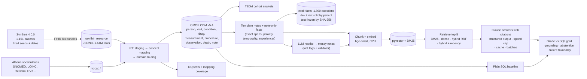

# synthea-omop-rag

> **All data in this project is synthetic** (generated by [Synthea](https://github.com/synthetichealth/synthea)).
> Nothing here describes real patients, and no result supports any clinical conclusion.

An end-to-end portfolio project in Real-World Evidence data engineering and applied GenAI:

1. **FHIR → OMOP.** Synthea FHIR R4 bundles → PostgreSQL (raw JSONB) → dbt → a subset of OMOP CDM v5.4 mapped to OHDSI standard concepts, with data-quality tests, mapping coverage as a metric, and an OHDSI-style cohort analysis.
2. **RAG over clinical notes.** Notes generated from the CDM with exact, span-level ground truth (plus an LLM-rewritten "messy" copy), chunked, embedded locally into pgvector, and retrieved with BM25, dense, hybrid and recency-aware hybrid search. Answers must cite the excerpts they used.
3. **Honest evaluation.** 1,800 SQL-checkable questions split by patient and frozen before any tuning; the 1,200-question test set was scored once. The report covers retrieval, accuracy, grounding and abstention with patient-clustered CIs, a plain-SQL baseline, and a failure analysis.

Every design choice has an Architecture Decision Record in [`docs/decisions/`](docs/decisions/). New terms are explained in [`docs/concepts.md`](docs/concepts.md).

## Architecture



## Headline results (test set, scored once)

1,200 questions about 150 held-out patients. Answers by Claude Opus 5.5 (effort low) from the top 5 retrieved excerpts. The 95% CIs come from a bootstrap that resamples **patients**, because questions about the same patient are correlated. Full tables: [`docs/results.md`](docs/results.md).

| Notes | Retrieval | Recall@5 | Answer accuracy | Claims supported by cited excerpt | Wrong answers after a retrieval miss |
|---|---|---|---|---|---|
| clean | dense | 0.719 | 0.827 [0.806, 0.846] | 0.885 | 118 |
| clean | hybrid (RRF) | 0.775 | 0.867 [0.849, 0.884] | 0.893 | 109 |
| clean | BM25 | 0.845 | 0.908 [0.892, 0.923] | 0.905 | 84 |
| clean | **hybrid + recency** | **0.894** | **0.925 [0.912, 0.938]** | 0.909 | **31** |
| messy (LLM-rewritten) | hybrid + recency | 0.913 | 0.942 [0.927, 0.955] | 0.917 | 26 |

What this shows, and what it doesn't:

- **Retrieval decides accuracy.** The four clean configurations rank identically on recall@5 and on accuracy. Most wrong answers are retrieval misses. When the gold evidence *was* shown, the model made at most 10 temporal or value errors per run of 1,200 questions, and no negation errors.
- **No answers to unanswerable questions.** All 184 "not documented" questions were abstained on, in every run.
- **The two best clean configurations differ mostly in safety.** Their accuracy intervals overlap. When retrieval missed the evidence, BM25 answered *wrongly* 84 times and abstained 6 times. Hybrid + recency answered wrongly 31 times and abstained 40 times.
- **Messy notes didn't lower aggregate accuracy, but not because messiness helps.** The rewrites are about 20% shorter, so fixed 800-character chunks carry about 13% more facts and the top 5 cover more evidence; most of the gain is on the latest lab value. Messiness itself cost rank-1 recall for every retriever, and cost stop-reason questions 1.00 → 0.80 (all safe abstentions). See [ADR-0015](docs/decisions/ADR-0015-evaluation.md).
- **The weak spot is the latest lab value** (0.61 on clean notes). Every failure is a retrieval miss, and the model then reports an *older* value as the latest. That is the most clinically dangerous pattern in the results.

### Where RAG adds value over SQL

The notes are generated from the CDM, so on structured questions **plain SQL is exact by construction**. The SQL baseline scores 1.000 on every structured template except one question: on a family-history trap, SQL counts *eclampsia* as a descendant of *seizure disorder* in SNOMED and so answers yes, where the note-level gold is no.

| Question type | SQL | RAG (clean, hybrid + recency) |
|---|---|---|
| Structured: conditions, diagnosis dates, current medications, latest lab, negation and family traps | 1.000 (one disagreement in 859) | 0.61–1.00 by template |
| Note-only: family history, reasons a drug was stopped | **not answerable** | **1.000** (157 questions) |
| "Not documented" | 1.000 (lab questions) | 1.000 (all 184) |

The honest conclusion: **use SQL for anything the CDM already structures**, since it's exact, cheap and auditable. RAG earns its place on information that **only exists in free text**. On structured questions it is worse, and its errors (stale lab values) are the ones that matter. Real notes are messier than these, and real structured data is less complete, so both sides of this comparison are optimistic.

### Failure analysis

Every wrong answer gets one cause (first match wins): answered the unanswerable → **retrieval miss** (split into *abstained*, the safe outcome, and *answered wrongly*, the unsafe one) → over-abstention → negation → family attribution → temporal → other. Counts and real examples are in [`docs/failure_analysis.md`](docs/failure_analysis.md). In short, retrieval misses account for 56–181 of each run's 70–208 errors, there are 8–19 over-abstentions with the evidence in view, there were no negation errors, and there was one family-attribution error, on the messy corpus.

### Grounding check, and how far to trust it

A claim counts as grounded only if a cited excerpt states **every** part of it: its date, its numbers, and at least 60% of its content words. The rule was settled on dev pilot answers after a stricter version and a looser version both failed (ADR-0015).

To check the rule, 50 random claims from the main run were labelled independently, with the automatic labels hidden. **These labels come from Claude (an LLM reader), not a human**, so they are a weaker check than the human calibration the design calls for. The human labelling file is still open (`eval/results/test/grounding_sample_TO_LABEL.csv`), and `rwe report` adds it when filled in.

- **Agreement 0.94, Cohen's κ 0.77.** The reader judged 0.88 of claims supported; the rule judged 0.82.
- **All 3 disagreements go one way:** the rule rejected claims that are supported (an abbreviation, "HTN" for essential hypertension; a diagnosis date and a resolution date in two different cited excerpts; a claim worded as commentary). The rule is **conservative**: if anything, it understates grounding.
- **All 6 unsupported claims share one pattern,** and the rule caught every one. The model added a diagnosis or resolution date that none of its cited excerpts shows. The headline answer was supported; the extra detail was not.

## Data engineering and RWE results

- **CDM:** 1,151 persons (151 deceased), 67,715 visits, 17,969 conditions, 72,577 drug exposures, 601,766 measurements, 83,545 procedures, 321,049 observations and 8,692 notes. Athena release v5.0 29-AUG-26.
- **Mapping coverage (records / distinct codes):**

  | Table | Records mapped | Codes mapped |
  |---|---|---|
  | drug | 100% | 100% |
  | measurement | 99.99% | 98.1% |
  | observation | 99.93% | 91.6% |
  | condition | 99.0% | 98.2% |
  | procedure | 87.3% | 40.7% |

  The procedure gap is CDT dental codes, which are ADA-licensed and not distributed through Athena. That is a licensing gap, not an ETL bug, and the coverage test warns about it as designed (ADR-0006).
- **Data quality:** 108 dbt data tests and 6 dbt unit tests cover keys, referential integrity, date logic, events after death (with the 60-day DQD grace), observation-period containment, plausible measurement ranges and conformance to the official CDM v5.4 field specification. The unit tests prove each DQ rule fires on deliberately corrupted rows (ADR-0009).
- **RWE analysis:** an incident type 2 diabetes cohort (n = 19 after attrition from 78) with a characterisation table, metformin drug eras and HbA1c windows; see [`analysis/t2dm_metformin/outputs/report.md`](analysis/t2dm_metformin/outputs/report.md). It demonstrates the method only: **Synthea's HbA1c follows simulator rules, not physiology** (ADR-0010).

## Limitations

- **Synthetic, templated notes give an optimistic upper bound.** Even the messy rewrite keeps every fact string verbatim (only the wording around it changes), and 61 of 5,626 test notes fell back to template text because rewrite validation failed.
- **SQL is a ceiling by construction.** Gold answers and notes come from the same CDM, so this design can't show RAG beating SQL on structured facts.
- **Small corpora per query.** Retrieval is patient-scoped (about 65 chunks per patient), the way chart search works. It says nothing about search across a whole hospital.
- **One model, one prompt, one run.** There's no repeat sampling, so the CIs cover patient sampling, not run-to-run model variance. The recency window (20) was chosen on dev, at the edge of the grid searched (ADR-0012).
- **The clean vs messy comparison is confounded** by chunk density (above). A fair test would hold facts per chunk or tokens per prompt fixed.
- **The grounding check is lexical and so slightly conservative** (abbreviations and evidence split across excerpts count against it). Its check against independent labels used an LLM reader, not a human; the human pass is still to do.
- **The test set was re-frozen once**, before any test answers existed, to fix a gold bug that changed a single line (disclosed in ADR-0015).
- **Spend:** $70.56 of a $75 cap. About $3.90 of it was wasted on resubmitting truncated rewrites, a bug that is now fixed and covered by a regression test (ADR-0014).

## Reproduce

Prerequisites: Docker with Compose, [uv](https://docs.astral.sh/uv/), make, and Java 17+ (for Synthea). Developed on WSL2 Ubuntu.

```bash
cp .env.example .env            # local settings; never committed
make install                    # exact dependency versions from uv.lock
make all                        # Postgres+pgvector, Synthea, ingest, vocab, dbt, analysis, notes, index
make test                       # pytest
```

The OHDSI vocabularies are licensed and can't be redistributed, so download them yourself from [Athena](https://athena.ohdsi.org). Tick **SNOMED, LOINC, RxNorm, RxNorm Extension, CVX, UCUM, ICD10CM, ATC, Gender, Race, Ethnicity, Visit, Type Concept, Condition Status**, leave CPT4 unticked, and unzip into `data/vocab/`.

The LLM steps need `ANTHROPIC_API_KEY` in `.env`. Every paid command has a `--dry-run` that prices it first, and a persistent ledger refuses any call that could cross `llm.budget_usd`.

```bash
uv run rwe final --corpus clean --mode hybrid_recency --dry-run   # price it
uv run rwe final --corpus clean --mode hybrid_recency --submit    # Message Batches, 50% price
uv run rwe final --corpus clean --mode hybrid_recency --collect   # book real cost, grade, store
uv run rwe report                                                 # tables + docs/results.md
```

Responses are cached in Postgres, so re-running a step never pays twice for the same answer. At October 2026 prices this project spent $70.56 in total: about $8 per clean answer run with Opus 5.5 via batches, $27 for the test-note rewrite with Sonnet 5.5 (plus the $3.90 waste), and about $3.50 for the dev pilot and the rewrite sample.

## Tests and CI

- `pytest`: 96 tests (unit tests, plus integration tests on a separate `<db>_test` database).
- GitHub Actions ([`.github/workflows/ci.yml`](.github/workflows/ci.yml)) runs lint, the tests, the full pipeline on a committed 20-patient FHIR fixture with a stub vocabulary, and `make ci-eval`. That last step runs the rewrite, answering, grading and report path with a deterministic fake embedder and a fake LLM: no key, no network, $0. CI checks the plumbing, not model quality. Locally, `make ci` runs the same steps in about 35 seconds.

## Reproducibility

- Every parameter that affects results is in [`config/pipeline.yaml`](config/pipeline.yaml). Profiles (`default`, `ci`) override it key by key, and each profile has its own database and output directories.
- Synthea runs with fixed seeds, reference and end dates, and UTC, so its output is byte-identical across runs. The jar is pinned by SHA-256, the Postgres image by digest, and the embedding model by commit, which then runs offline.
- Each run writes `data/runs/<timestamp>/manifest.json` with the git SHA, seeds, package versions, the vocabulary release and the resolved config.
- The test set is frozen in [`eval/test_set.sha256`](eval/test_set.sha256), and the code refuses to score the test split outside the final evaluation.
