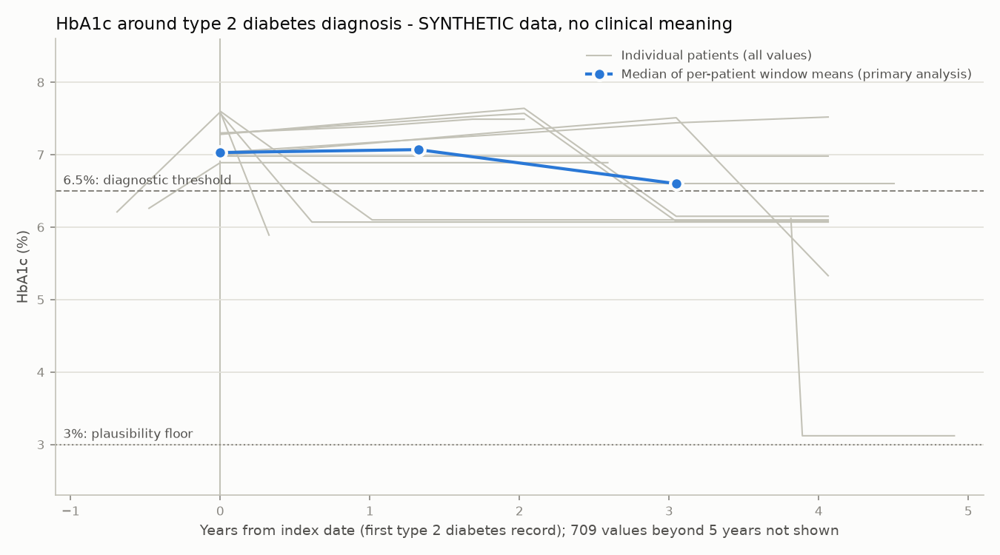

# Incident type 2 diabetes: metformin exposure and HbA1c over time

> **Synthetic data (Synthea). This analysis demonstrates OMOP CDM methodology; it supports no clinical conclusion.** Synthea's HbA1c follows simulator rules, not physiology (see *What this does and does not show*).

Vocabulary: `v5.0 29-AUG-26` - config fingerprint `46f73a50ebb6` - small-cell suppression: counts below 5 shown as `<5`. Cohort definition: ADR-0010.

## Cohort attrition

|   step | criterion                                                            |   persons |
|-------:|:---------------------------------------------------------------------|----------:|
|      1 | Any type 2 diabetes record (first record = index date)               |        78 |
|      2 | Index date inside observation period                                 |        78 |
|      3 | Aged 18 or over at index                                             |        78 |
|      4 | At least one visit in the 365 days before index (observed look-back) |        19 |
|      5 | No type 1 diabetes record on or before index                         |        19 |

## Baseline characteristics (Table 1)

| Characteristic                           | Value                    | Section                              |
|:-----------------------------------------|:-------------------------|:-------------------------------------|
| Persons                                  | 19                       |                                      |
| Age at index, mean (SD)                  | 52.3 (12.1)              | Demographics                         |
| Age at index, median [IQR]               | 55 [44, 60] (n=19)       | Demographics                         |
| Sex: FEMALE                              | 7 (37%)                  | Demographics                         |
| Sex: MALE                                | 12 (63%)                 | Demographics                         |
| Race: Black or African American          | <5                       | Demographics                         |
| Race: White                              | 18 (95%)                 | Demographics                         |
| Ethnicity: Hispanic or Latino            | 5 (26%)                  | Demographics                         |
| Ethnicity: Not Hispanic or Latino        | 14 (74%)                 | Demographics                         |
| Hypertension                             | 8 (42%)                  | History on or before index           |
| Dyslipidaemia                            | <5                       | History on or before index           |
| Obesity                                  | 14 (74%)                 | History on or before index           |
| Prediabetes                              | 15 (79%)                 | History on or before index           |
| Ischaemic heart disease                  | 6 (32%)                  | History on or before index           |
| Chronic kidney disease                   | <5                       | History on or before index           |
| Diabetic kidney/eye/nerve complication   | <5                       | History on or before index           |
| Metformin                                | 0 (0%)                   | Drugs in 365 days before index       |
| Any diabetes drug (ATC A10)              | 0 (0%)                   | Drugs in 365 days before index       |
| Lipid-modifying agent (ATC C10)          | <5                       | Drugs in 365 days before index       |
| Renin-angiotensin agent (ATC C09)        | <5                       | Drugs in 365 days before index       |
| Beta blocker (ATC C07)                   | <5                       | Drugs in 365 days before index       |
| BMI, kg/m2                               | 29.1 [27.9, 29.8] (n=15) | Last value in 365 days before index  |
| HbA1c %, plausible values only (primary) | 7.28 [6.99, 7.45] (n=15) | Last value in 365 days before index  |
| HbA1c %, all values (sensitivity)        | 7.28 [6.99, 7.45] (n=15) | Last value in 365 days before index  |
| Follow-up, years                         | 4.1 [1.8, 7.1] (n=19)    | Index to end of observation or death |

## Metformin exposure

Exposures are joined into eras with the OHDSI DRUG_ERA rule (gaps of 30 days or less merge). Each prescription counts as a 30-day exposure (THEMIS convention, ADR-0007), so era lengths inherit that assumption.

| Measure                                                      | Value                |
|:-------------------------------------------------------------|:---------------------|
| Cohort persons                                               | 19                   |
| Metformin in the 365 days before index                       | 0 (0%)               |
| Started a metformin era on or after index (during follow-up) | 10 (53%)             |
| ... of whom within 365 days of index                         | <5                   |
| Days from index to first metformin era, median [IQR]         | 742 [0, 1097] (n=10) |
| Length of first metformin era in days, median [IQR]          | 30 [30, 30] (n=10)   |
| Metformin eras per treated person, median [IQR]              | 3 [2, 6] (n=10)      |

## HbA1c over time

Per window, each person's values are averaged, then the median [IQR] across persons is reported. The primary analysis excludes 154 values below the 3% plausibility floor (Phase 2 data-quality rule); the sensitivity analysis keeps them.

**Analysis horizon: 5 years after index. This was decided after looking at the data, not pre-specified.** A few people have follow-up of several decades with sparse values, and an open-ended last window made the plotted median imply a trend across 35 years. The >5-year row is still reported, but not interpreted.

### Primary (plausible values)

| Window from index                                     | Persons   |   Values | Per-person mean HbA1c %, median [IQR]   |
|:------------------------------------------------------|:----------|---------:|:----------------------------------------|
| baseline (-365 to 0 d)                                | 15        |       17 | 7.03 [6.98, 7.31] (n=15)                |
| 0-6 months                                            | <5        |        1 | n<5, not shown                          |
| 6-12 months                                           | <5        |       26 | n<5, not shown                          |
| 1-2 years                                             | 10        |       24 | 7.07 [6.67, 7.37] (n=10)                |
| 2-5 years                                             | 11        |       47 | 6.60 [6.31, 6.94] (n=11)                |
| >5 years (beyond the 5-year horizon; not interpreted) | 8         |      555 | 4.75 [3.66, 6.07] (n=8)                 |

### Sensitivity (all values)

| Window from index                                     | Persons   |   Values | Per-person mean HbA1c %, median [IQR]   |
|:------------------------------------------------------|:----------|---------:|:----------------------------------------|
| baseline (-365 to 0 d)                                | 15        |       17 | 7.03 [6.98, 7.31] (n=15)                |
| 0-6 months                                            | <5        |        1 | n<5, not shown                          |
| 6-12 months                                           | <5        |       26 | n<5, not shown                          |
| 1-2 years                                             | 10        |       24 | 7.07 [6.67, 7.37] (n=10)                |
| 2-5 years                                             | 11        |       47 | 6.60 [6.31, 6.94] (n=11)                |
| >5 years (beyond the 5-year horizon; not interpreted) | 8         |      709 | 4.75 [3.66, 6.07] (n=8)                 |

## What this does and does not show

HbA1c across the whole synthetic population, by type 2 diabetes status:

| group_                            |   persons |   hba1c_values |   median_pct |   pct_values_ge_6_5 |
|:----------------------------------|----------:|---------------:|-------------:|--------------------:|
| No type 2 diabetes record         |       397 |           6750 |         3.96 |                 0   |
| Type 2 diabetes record (any time) |        78 |           3332 |         3.97 |                11.2 |

What is plausible: around diagnosis, this cohort's HbA1c is in the diabetic range (baseline median of per-person means 7.03%, 1-2 years 7.07%), so Synthea does model HbA1c rising to a diagnosis.

What is not: over long follow-up, values drift down well below the diabetic range (beyond 5 years after index: 4.75%, with 154 of 709 values under the 3% plausibility floor; this is a data-quality observation, outside the analysis horizon); people with no diabetes record have a median of 3.96%, below the usual adult range; and within a person values move in smooth monotone steps. The trajectory is produced by Synthea's disease-module rules, not by physiology or by any drug. **So no statement about glycaemic control or metformin effect can be made from these numbers**, and a before/after comparison around metformin would only recover the simulator's rules.

What the analysis does show is the method: concept sets with descendants, an incident cohort with an observed look-back, attrition, time-anchored covariates, drug eras, measurement windows relative to index, a pre-specified plausibility rule with a sensitivity analysis, and small-cell suppression.

## Limitations

- n is small (see attrition); estimates are descriptive only, with no inference.
- The observed look-back (one visit in the prior year) cannot guarantee incidence: earlier diagnoses outside the exported history window would be missed (ADR-0005).
- The single observation period per person counts gaps in care as observed time (ADR-0008).
- Drug era lengths depend on the 30-day prescription assumption (ADR-0007).
- Only primary small-cell suppression is applied. A suppressed cell can sometimes be recovered from its complement (e.g. a race category where the other categories are shown). Releasing real data would need complementary suppression too; it is not implemented here because the data are synthetic.
